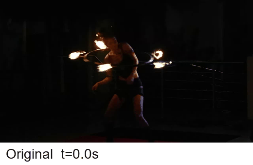
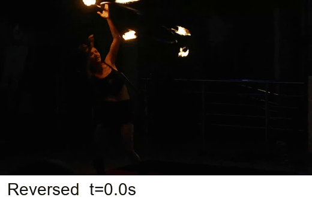
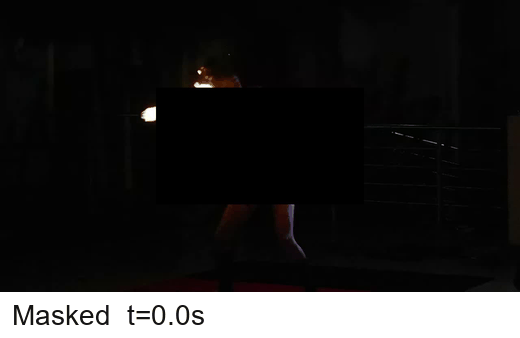

# Hallucination Dataset Annotation and Evaluation Tools

This repository contains the small set of tools needed to review VHD question
labels and run video-language models on the benchmark. The video files are not
stored in this repository.

## 1. Download the Dataset

Download the videos and question files from Kaggle:

https://www.kaggle.com/datasets/mlopssss/video-hallucination-diagnosis

Extract the Kaggle dataset beside this repository, for example:

```text
hallucinationdataset/
VHD_pilot_dataset/
```

The extracted dataset should contain:

```text
VHD_pilot_dataset/videos/
VHD_pilot_dataset/questions/vhd_questions.csv
```

## 2. Install Dependencies

```bash
pip install -r requirements.txt
```

For model inference with Qwen2.5-Omni, use:

```bash
pip install -r requirements_omni.txt
```

## 3. Start Human Label Review

The review tool opens a local desktop window, shows each video with its
question and answer options, and writes the selected labels back to a CSV file.

Copy the question CSV before editing it:

```bash
cp ../VHD_pilot_dataset/questions/vhd_questions.csv reviewer_1.csv
```

Start the review app:

```bash
python scripts/review_question_labels_app.py \
  --dataset-root ../VHD_pilot_dataset \
  --csv reviewer_1.csv
```

On Windows PowerShell:

```powershell
Copy-Item ..\VHD_pilot_dataset\questions\vhd_questions.csv reviewer_1.csv
python scripts\review_question_labels_app.py --dataset-root ..\VHD_pilot_dataset --csv reviewer_1.csv
```

The output is the same CSV file, updated with human labels such as:

```text
question_valid
final_correct_answer
final_A_language_prior
final_A_vision
final_uncertainty_label
```

## 4. Run a Video-Language Model

`scripts/run_model_responses.py` runs a supported multimodal model on the VHD
questions and saves both a CSV checkpoint and a JSONL recovery ledger.

Example:

```bash
python scripts/run_model_responses.py \
  --model-key qwen \
  --dataset-root ../VHD_pilot_dataset \
  --manifest metadata_examples/evaluation_manifest.csv \
  --output-dir outputs \
  --save-every 5
```

Supported model keys:

```text
qwen    Qwen/Qwen2.5-Omni-3B
qwen7   Qwen/Qwen2.5-Omni-7B
```

The output directory will contain files such as:

```text
outputs/qwen2_5_omni_3b_responses.csv
outputs/qwen2_5_omni_3b_responses.jsonl
outputs/qwen2_5_omni_3b_run_metadata.json
```

The CSV keeps the model answer, confidence, parser status, video path, question
metadata, and final human labels needed for scoring.

## 5. Visual Example

The same fire clip is shown under the three VHD conditions.

### Original



### Temporally Reversed



### Masked



The original clip is used for ordinary accuracy questions. The reversed clip is
used for PDI, where the model must follow the visible temporal evidence rather
than the usual event order. The masked clip is used for HCE, where the model
should avoid high confidence when key evidence is hidden.

## Repository Contents

```text
scripts/review_question_labels_app.py   # Human label review GUI
scripts/run_model_responses.py          # Model inference and CSV saving
metadata_examples/evaluation_manifest.csv
metadata_examples/vhd_questions.csv
assets/gifs/
```

Large videos should always be downloaded from Kaggle rather than committed to
GitHub.
